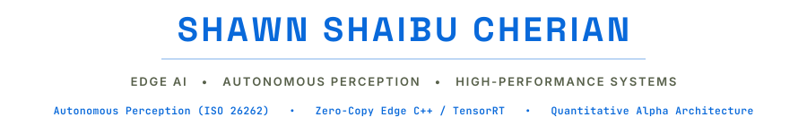

<div align="center">
  

  <p align="center">
    <a href="https://github.com/wwwrryyy"></a>
    <a href="mailto:shawnsc76@gmail.com">
  </p>
</div>

---

### Machined Stack

#### Languages & Compute


#### Edge & Acceleration


---

### Core Disciplines & Telemetry

```
[01] Autonomous Perception & ADAS  -> Spiking Neural Networks (SNN), sub-33ms real-time inference (30+ FPS), ISO 26262 ASIL-B compliance
[02] Edge Acceleration & C++       -> Zero-copy pybind11 native bridges, TensorRT / ONNX Runtime, CUDA kernels on NVIDIA Jetson Orin Nano
[03] Quantitative Alpha & Risk     -> Market/sector-residualized returns, continuous event-decay kernels, forward-filtered regime HMMs
[04] Multimodal Edge Intelligence  -> Autonomous multispectral/SAR processing, real-time WGS84 GIS projection, offline telemetry resilience
```

---

### Flagship Systems

| System | Architecture & Specification | Stack | Repository |
| :--- | :--- | :--- | :--- |
| **Canopy AI** | Autonomous drone edge compute for precision agriculture & environmental anomaly detection. Multispectral/SAR sensor intake, structural difference calculus with native C++ bridge, and georeferenced WGS84 prescription maps on Jetson Orin Nano. | `C++`, `PyTorch`, `ONNX`, `Jetson` | [canopy-ai](https://github.com/wwwrryyy/canopy-ai) |
| **Stockman (QARE-MM)** | Institutional-grade multi-modal quantitative alpha & risk engine. Sample-efficient swing trading with cross-sectional rank normalization, microstructure & overnight decomposition, and variance-sorted HMM regimes. | `Python`, `PyG`, `LightGBM`, `HMM` | [stockman](https://github.com/wwwrryyy/stockman) |
| **ADAS & Autonomous Vision** | Safety-critical adverse weather perception pipeline. Real-time Spiking Neural Networks (SNNs) for noise filtering, scene reconstruction, hazard detection, and pixel-wise anomaly calculus under 33ms latency budget. | `C++`, `pybind11`, `SNN`, `ASIL-B` | [ADAS Perception](https://github.com/wwwrryyy) |
| **Medical Diagnostics AI** | High-precision medical imaging diagnostic pipeline with temperature-scaled confidence gating, calibrated uncertainty routing, and deterministic edge verification. | `PyTorch`, `Edge AI`, `Inference` | [medical-imaging](https://github.com/wwwrryyy/medical-imaging) |
| **CAI (Chartered AI)** | Autonomous tax intelligence agent fusing multimodal document vision (Gemma 3) with deterministic, budget-verified financial calculation engines. | `FastAPI`, `Gemma 3`, `Multimodal` | [cai](https://github.com/wwwrryyy/cai-chartered-artificial-intelligence) |

---

### Telemetry Link

```bash
$ curl -s https://api.github.com/users/wwwrryyy | jq '{name, bio, location, public_repos}'
{
  "name": "Shawn Shaibu Cherian",
  "focus": "Edge AI • Autonomous Perception • High-Performance Systems",
  "email": "shawnsc76@gmail.com",
  "github": "https://github.com/wwwrryyy"
}
```

<div align="center">
  <sub><code>Art, Forme, Technique • Precision Engineered by @wwwrryyy</code></sub>
</div>
